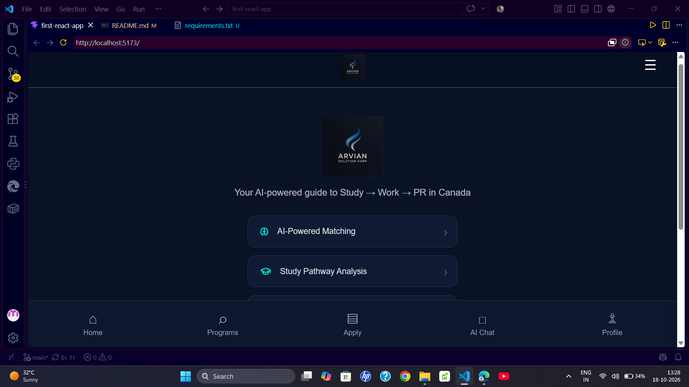
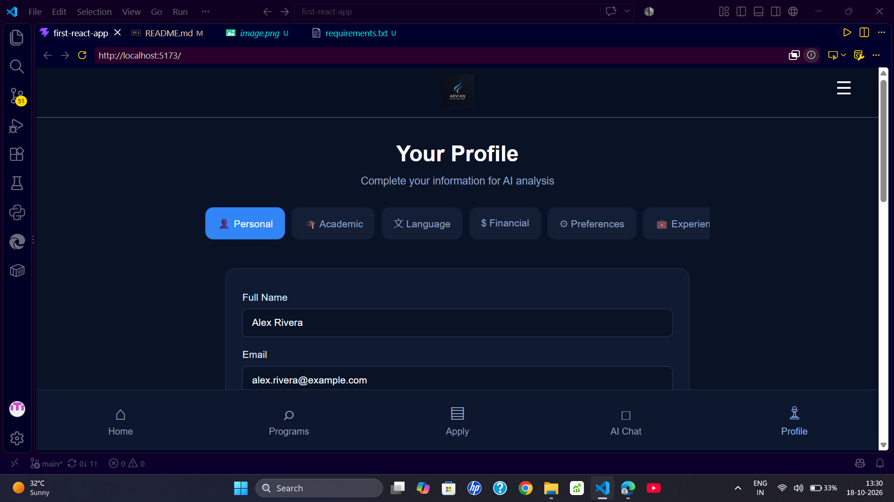
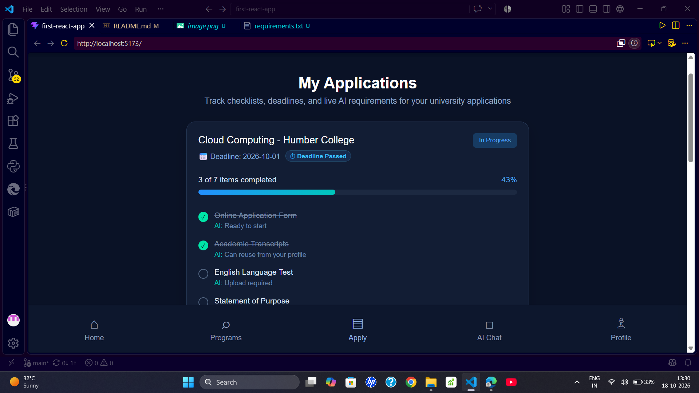

# AI Student Pathway Platform

A full-stack web app that helps international students plan a study-and-immigration pathway to Canada. Enter your academic, language, financial and skills profile and get a weighted readiness score, AI-recommended career tracks, matched programs, an application checklist and a profile-aware AI advisor chat.

> **Disclaimer:** Scores and pathway guidance are estimates for planning purposes only. They are not legal or immigration advice. Always verify requirements (study permit, financial proof, PNP and Express Entry rules) with official IRCC sources.

## Features

- **Profile intake:** CGPA, IELTS bands, budget, funding sources, skills, preferred provinces.
- **Readiness score:** weighted score across Academic (25%), Language (20%), Financial (20%), Career (20%) and Visa/PR (15%).
- **Career recommendations:** RandomForest model (scikit-learn) that predicts suitable tech career tracks from skills and experience.
- **Program matching:** browse and filter programs with match scores, fees, intakes and career tracks.
- **Application tracker:** per-application checklist with progress.
- **AI advisor chat:** profile-aware chat powered by Google Gemini, with automatic fallback to a local heuristic engine.
- **Offline-resilient:** if the backend is down, the frontend falls back to client-side scoring so the app keeps working.

## Tech Stack

| Layer | Technology |
|-------|------------|
| Frontend | React 19, Vite, Context API, plain CSS |
| Backend | FastAPI, Pydantic, Uvicorn |
| ML | scikit-learn (RandomForest), pandas, joblib |
| AI | Google Gemini API (REST) |
| Tooling | Oxlint |

## Project Structure

```
first-react-app/
├── src/
│   ├── Pages/            # Screens (Home, Profile, Programs, Apply, AIChat, ...)
│   ├── component/        # Navbar, Footer
│   ├── context/          # StudentContext (profile, analysis, applications, chat)
│   ├── App.jsx           # Screen navigation and sign-in demo modal
│   └── main.jsx
├── backend/
│   ├── main.py           # FastAPI app and routes
│   ├── models.py         # Pydantic request/response models
│   ├── train_model.py    # Trains the career RandomForest model
│   ├── data/             # career_dataset.csv (model is generated locally)
│   └── services/         # scoring, ml_career, gemini_advisor, programs_catalog
├── .env.example
├── package.json
└── README.md
```

## Getting Started

### Prerequisites

- Node.js 18+ and npm
- Python 3.10+

### 1. Clone

```bash
git clone https://github.com/<your-username>/<your-repo>.git
cd <your-repo>
```

### 2. Backend

```bash
python -m venv .venv

# Windows
.venv\Scripts\activate
# macOS / Linux
source .venv/bin/activate

pip install -r backend/requirements.txt

# Train the career model (creates backend/data/career_model.pkl)
python backend/train_model.py

# Run the API from the project root
uvicorn backend.main:app --reload --port 8000
```

API docs: http://127.0.0.1:8000/docs

### 3. Environment variables

```bash
cp .env.example .env      # Windows: copy .env.example .env
```

Edit `.env`:

```
GEMINI_API_KEY=your_key_here
GEMINI_MODEL=gemini-2.5-flash
```

Get a free key at https://aistudio.google.com/app/apikey. The key is optional: without it, the chat uses the built-in local engine.

### 4. Frontend

```bash
npm install
npm run dev
```

Open http://localhost:5173

On Windows, `start-dev.bat` launches both servers.

## API Endpoints

| Method | Endpoint | Description |
|--------|----------|-------------|
| GET | `/health` | Service status |
| POST | `/api/score` (alias `/predict`) | Evaluate a student profile |
| GET | `/api/programs` | Search programs (`query`, `province`, `country`, `track`) |
| POST | `/api/chat` | AI advisor reply (Gemini with local fallback) |
| GET | `/api/gemini/status` | Whether a Gemini key is configured |

## How Scoring Works

Each category is scored 0-100, then combined:

```
overall = 0.25*academic + 0.20*language + 0.20*financial + 0.20*career + 0.15*visa_pr
```

The scoring rules live in `backend/services/scoring.py`. The frontend has an equivalent offline fallback in `src/context/StudentContext.jsx`.

## Roadmap

- [ ] Replace state-based navigation with React Router
- [ ] Build remaining screens (Timeline, Counsellor, Visa Risks, Work Pathway, Provincial PR, Match Justification, Risks & Gaps, AI Assistant)
- [ ] Single source of truth for scoring (backend only)
- [ ] Send chat history to Gemini for multi-turn conversations
- [ ] Real authentication
- [ ] Unit tests for scoring and API
- [ ] Deployment (frontend and backend)

## Screenshots




